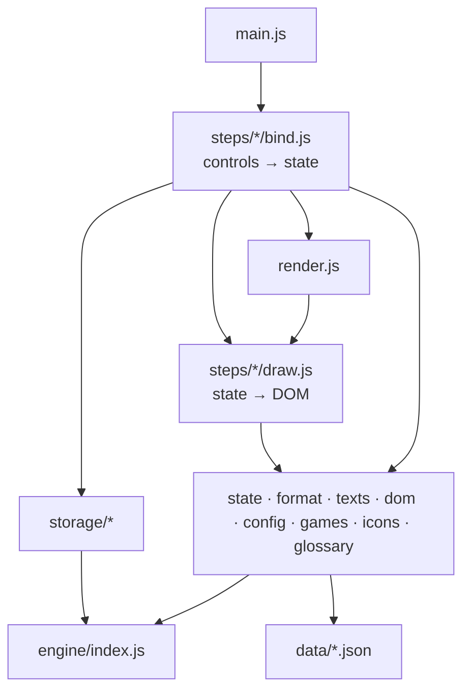

# Architecture

The simulator is a plain-JavaScript page with no framework, no server and no runtime dependency, built like
the [banking churn demo](https://github.com/FrtZi/banking-churn-demo): small ES modules, bundled with the game
data into one self-contained `dist/index.html`, published on GitHub Pages. As of 23 October 2026, version 1.0: the game data with their
checks, the engine (effective stats, armies, power, profile, battle, comparison, dashboards' figures) and the
page (game, bonuses, compositions, profile, comparison, six dashboards, saves); what comes next is in
[the product backlog](docs/backlog.md).

Three rules hold the structure together:

1. **The engine knows nothing about the page.** It is pure computation, testable in Node.
2. **Facts live in data, not in code.** The game's facts are JSON files in `data/`; the code holds no figure.
3. **A player's data never leaves their browser.** No server, no shared database, no analytics
   ([docs/decisions.md](docs/decisions.md), D-01).

## Folders

```
data/                    each game's facts (JSON), the same for every player (D-13)
├── games.json           the games the simulator knows: id and names
└── chaos-conquest/      Warhammer: Chaos & Conquest
    ├── game.json        vocabulary: tiers, recruitments, attack types, unit types, alignments, buildings, stats, source kinds
    ├── defences.json    one entry per fortress defence (never part of an army)
    ├── units.json       one entry per troop type, from its in-game sheet
    ├── combat-rules.json  the combat rules the game publishes, with their source
    └── warlords.json    the 33 warlords, at each of 35 levels: imported (scripts/import-warlords.mjs), never edited
src/engine/              pure functions, no DOM, no file access: callers pass the data
├── index.js             public API: the only file the page and the tests import
├── targets.js           which troops an effect selects (TARGET_FIELDS)
├── sources.js           a player's bonus sources → effects (one resolver per kind; manual only, 2026-10-22)
├── bonuses.js           checks a bonus a player enters: stat, 0–100 %, target (D-14)
├── stats.js             effective stats; march capacity as base, bonus, total (D-12)
├── army.js              an army: lines (troops, then heroes), size against the capacity, power
├── heroes.js            heroes (D-26): rank and level, a hero as a unit of one, talents offered and chosen, rules
├── combat.js            per-troop damage and health, tier modifier, melee or ranged (D-16)
├── allocate.js          where a strike's damage goes: lowest tier first, then the order within a tier
├── morale.js            morale tests and rallying
├── battle.js            the battle: turns, strikes, morale, power lost, winner
├── measures.js          army damage and health in one strike (SIM-07)
├── profile.js           the army's profile: damage, tanking (health, armour), morale, speed, load, upkeep
├── compare.js           two armies: each figure, its difference and the better one, both battles (SIM-03)
└── insights.js          the dashboards' figures: efficiency, rounds, balance and warnings, pros and cons
src/storage/             no DOM: configuration.js (setup ↔ file format version 2, checks), migrate.js (an older
                         file brought up to date), browser.js (saves)
src/index.html           page shell: head, header (flags, theme), footer, one include per section
src/theme-init.js        sets the theme before the first paint (inlined in <head>)
src/assets/              the language flags (inlined by the build)
src/main.js              entry point: binds every control, then draws the page
src/ui/                  the page
├── config.js            CONFIG: every tunable value of the interface
├── games.js             the games and their data (the JSON imports the build bundles)
├── state.js             the single mutable state, and what derives from it (effects, army, profile)
├── render.js            the render pipeline: what to redraw after a change
├── texts/               the page's texts: en.js + en-more.js + en-dash.js, and the same in French (same keys), t()
├── format.js, dom.js    numbers and names in the current language; small DOM helpers
├── icons.js             the page's SVG icons and the troop type pictograms (D-18)
├── charts/             scatter.js: the scatter chart of three dashboards; zoom.js: drag a box, + and −;
│                        hover.js: a dot's name while pointing at it; table.js: the chart as a table (D-24)
├── filters.js           the troop filters (several values each) shared by the picker and the charts
├── glossary/            terms.js (definitions, both languages), tooltip.js (the dotted terms)
└── steps/<part>/        everything a part of the page needs: <part>.html (its markup, included by the build),
                         draw.js (state → DOM), bind.js (controls → state), and its own styles if any:
                         page (language, theme), game, bonuses, army (+ compositions), picker, heroes
                         (+ picker.js; heroes.js beside state.js works out a composition's heroes),
                         profile (+ table.js: key columns and their details), compare, dashboards
                         (one file per tab: efficiency + raiding, rounds, balance, map, pros; dashboards.css), saves
src/styles/              the shared design: tokens.css (colours, both themes), base, layout, forms, lists, figures,
                         responsive
scripts/
├── page.mjs             assembles index.html from its sections, fills in the English texts
├── build.mjs            bundles and inlines everything (esbuild) → dist/index.html
├── serve.mjs            npm run dev: serves the source page and data/ (no build)
├── catalogue.mjs        reads the feature catalogue (docs/features.md)
├── import-warlords.mjs  data/<game>/warlords.json from cctools.cc's saved pages (D-25)
├── backlog*.mjs         the product backlog: its check and its page docs/backlog.md (npm run backlog)
└── defects*.mjs         the defects register: its format, its check, its page docs/defects.md (npm run defects)
examples/
└── configuration.example.json   a fictitious player configuration, in the saved format
captures/<game>/         in-game screenshots: local only, ignored by git (see captures/README.md)
docs/                    one page per subject, each linking back here
tests/                   node --test; each test names the feature it proves
├── data, engine, battle, dashboards, backtest, storage   the data, the engine and the saves, in Node
├── page.test.js         the published page, driven in jsdom (page.js: opening it, clicking, typing)
├── accessibility.test.js   axe-core on the page in both languages; colour contrast from the tokens
├── tooling.test.js      the page assembler, the dev server, configurations aligned (MAINT-04)
├── performance.test.js  the worst comparison against a phone's budget (PERF-01)
├── warlords.test.js     the warlords: complete at every level, their talents valid bonuses (DATA-05)
├── crosscheck.test.js   data/ against the game's data from cctools.cc (local only, D-25)
└── catalogue, defects, backlog   the catalogue against the tests (MAINT-02); the defects and backlog checkers
```

## Layers

Arrows read "imports". Each layer only imports from the layers below it.



`render.js` never imports a `bind.js`, and a `draw.js` never imports `render.js`: that keeps the graph free of
cycles. The engine imports nothing from the page.

## The render pipeline

`src/ui/render.js` decides what to redraw; every control calls one of its two functions:

| A control changes…                                        | It calls      | Which redraws                                                                      |
| --------------------------------------------------------- | ------------- | ---------------------------------------------------------------------------------- |
| the language, the game, a bonus or troop added or removed | `renderAll()` | every part, keeping the focus where it was                                         |
| a value typed in: a percentage, a count, the capacity     | `refresh()`   | the bonus problems, the capacity bar, the profile — never the field being typed in |

The picker redraws only itself while searching, filtering and ticking; adding the ticked troops redraws the
army lines and the profile.

## Documentation

| Page                                        | Says                                                                                           |
| ------------------------------------------- | ---------------------------------------------------------------------------------------------- |
| [data-model.md](docs/data-model.md)         | units, effects, sources (hero, ritual, champion, armour, building), the player's configuration |
| [features.md](docs/features.md)             | what the simulator does, and what proves it                                                    |
| [decisions.md](docs/decisions.md)           | why these choices, and the options set aside                                                   |
| [open-questions.md](docs/open-questions.md) | what is still to confirm, and the next steps                                                   |
| [backlog.md](docs/backlog.md)               | what is left to do: milestones, priorities, dependencies (generated from backlog.toml)         |
| [defects.md](docs/defects.md)               | what broke, and what we learnt (generated from defects.toml)                                   |

## Where things live

| Kind of data                              | Place                                    |
| ----------------------------------------- | ---------------------------------------- |
| A game fact (unit stat, rule, vocabulary) | `data/*.json`                            |
| A player's configuration                  | their browser, and the files they export |
| A screenshot                              | `captures/`, on this computer only       |
| A tunable value of the interface          | `CONFIG` in `src/ui/config.js`           |
| A text of the page                        | `src/ui/texts/en.js` and `fr.js`         |
| An in-game name                           | `labels` in `data/<game>/*.json`         |
| A colour                                  | tokens in `src/styles/tokens.css`        |
| The page's language choice                | the player's browser (`localStorage`)    |

## Design principles

The golden rules shared by all our projects (see CLAUDE.md), applied here with the simplest means that work:

- **DRY.** Each fact exists once: the vocabulary in `data/<game>/game.json`, every bonus as the same effect shape,
  whatever its source.
- **KISS.** No framework, no server, no database: JSON files, pure functions, one page.
- **YAGNI.** The heroes, rituals, champion, armour and buildings have a documented shape, but no file and no
  code until a feature uses them. The interface comes after the engine.
- **Package by feature.** The first level of `src/` separates the functional families — the calculation
  (`engine/`), the access to saves (`storage/`), the screen (`ui/`) — and each part of the page keeps its
  markup, code and own styles together in `ui/steps/<part>/`. The same names run through the tests
  (`engine`, `battle`, `dashboards`, `storage`, `page`). `src/styles/` holds only what every part shares (the
  tokens and common components): one design, checked for contrast in one place.
- **Configurations aligned.** The git hook and the CI run the same command (`npm run check`); the Node
  version of `package.json` and of the CI, and that command in both, are checked to agree (MAINT-04).
- **Single responsibility.** One file, one job. ESLint caps files at 150 lines, functions at 60, complexity
  at 12.
- **Open / closed.** A new source kind is declared (catalogue, resolver, `sourceKinds` entry); the engine
  that applies effects does not change. A new unit is one entry in `units.json`.
- **Small interfaces.** The page and the tests only import `engine/index.js`.
- **Dependency inversion, where it pays.** Engine functions receive the units, effects and rules they work
  on; they never read files or the browser themselves.

## Checks

`npm run check` runs Prettier, the defects register check (it regenerates `docs/defects.md`, the only generated
doc, ignored by Prettier), ESLint, the tests (it builds `dist/` first: the page tests drive the published
file) and html-validate. The git hook (`.githooks/pre-commit`, enabled with `git config core.hooksPath
.githooks`) runs it before each commit, with a secret scan (gitleaks); the CI runs both on every push, then
deploys `dist/` to GitHub Pages from `main`.

## Conventions

- No inline style in the HTML and no colour in JavaScript: colours are tokens.
- A status is never shown by colour alone: an icon (✓, ⚠) and words go with it.
- Every text of the page has a key in both `en.js` and `fr.js` (tested); the build fills the English ones into
  the HTML, so the page reads in full before its script runs.
- Each control has a label; icon buttons have an accessible name.
