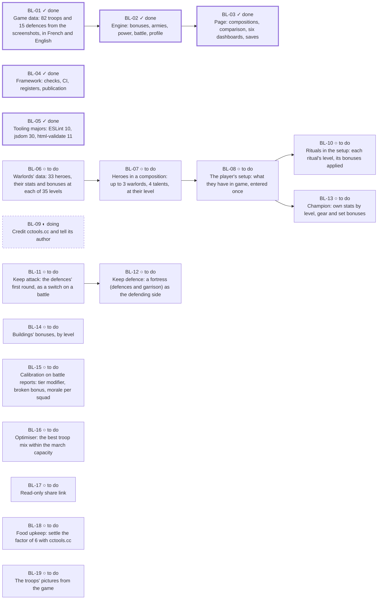

<!-- Generated by scripts/backlog.mjs from docs/backlog.toml: never edit by hand. -->
# Product backlog

[← Overview](../ARCHITECTURE.md) · Source: [backlog.toml](backlog.toml) · What each feature does
and what proves it: [features.md](features.md) · Why: [decisions.md](decisions.md)

What is left to do, in what order, and when each version is reached. Each item has a **MoSCoW**
priority (*must*, *should*, *could*, *won't* this time), a milestone, its dependencies and its
to-do list. A version is reached when every Must of its milestone is done. A new request enters
`backlog.toml` as an item; its catalogue features follow, as *Planned*, once Frantz validates them.

Statuses: ✓ done, ◐ doing, ○ to do.

## Where we stand

| Milestone | Musts done | Items done | Tasks done | Reached |
|---|---|---|---|---|
| Version 1.0, the troops | `████████████████████` 4/4 | 4/4 | 13/13 | ✓ reached, tag v1.0.0 |
| Version 1.1, heroes and the player's setup | `█████░░░░░░░░░░░░░░░` 1/4 | 1/5 | 5/16 | ○ not yet: 3 Musts left |
| Version 1.2, rituals and the keep | `░░░░░░░░░░░░░░░░░░░░` 0/2 | 0/4 | 0/10 | ○ not yet: 2 Musts left |
| Later, ideas kept | `░░░░░░░░░░░░░░░░░░░░` 0/0 | 0/6 | 0/7 | — |

## Ready to start

Not done, and every dependency done:

- [BL-06](#bl-06) Warlords' data: 33 heroes, their stats and bonuses at each of 35 levels (v1.1, must, ○ to do)
- [BL-09](#bl-09) Credit cctools.cc and tell its author (v1.1, could, ◐ doing)
- [BL-11](#bl-11) Keep attack: the defences' first round, as a switch on a battle (v1.2, must, ○ to do)
- [BL-15](#bl-15) Calibration on battle reports: tier modifier, broken bonus, morale per squad (later, should, ○ to do)
- [BL-14](#bl-14) Buildings' bonuses, by level (later, could, ○ to do)
- [BL-16](#bl-16) Optimiser: the best troop mix within the march capacity (later, could, ○ to do)
- [BL-17](#bl-17) Read-only share link (later, could, ○ to do)
- [BL-18](#bl-18) Food upkeep: settle the factor of 6 with cctools.cc (later, could, ○ to do)
- [BL-19](#bl-19) The troops' pictures from the game (later, won't, ○ to do)

## Dependencies

## Items

### v1.0 · Version 1.0, the troops

Every troop and defence of the game, the engine (bonuses, armies, power, battle), the page with its compositions, comparison, six dashboards and saves, published on GitHub Pages.

| ID | Item | MoSCoW | Module | Status | Tasks |
|---|---|---|---|---|---|
| [BL-01](#bl-01) | Game data: 82 troops and 15 defences from the screenshots, in French and English | must | [data](../data) | ✓ done | 3/3 |
| [BL-02](#bl-02) | Engine: bonuses, armies, power, battle, profile | must | [engine](../src/engine) | ✓ done | 2/2 |
| [BL-03](#bl-03) | Page: compositions, comparison, six dashboards, saves | must | [ui](../src/ui) | ✓ done | 4/4 |
| [BL-04](#bl-04) | Framework: checks, CI, registers, publication | must | framework | ✓ done | 4/4 |

#### BL-01 · Game data: 82 troops and 15 defences from the screenshots, in French and English

Must · [data](../data) · ✓ done · added `2026-10-22` · features: GAME-01, DATA-01, DATA-02, DATA-03, DATA-04, LANG-01

- [x] Troops of the five buildings and the fifteen defences transcribed
- [x] Checked against an independent control (D-10) and the game's data (D-25)
- [x] English names: the game's own (DEF-025)

#### BL-02 · Engine: bonuses, armies, power, battle, profile

Must · [engine](../src/engine) · ✓ done · added `2026-10-22` · after [BL-01](#bl-01) · features: BONUS-01, BONUS-02, ARMY-01, ARMY-02, SIM-01, SIM-02, SIM-07, SIM-08

- [x] Effective stats with bonuses, march capacity
- [x] Battle: the published rules and the community wiki's formulas (D-16)

#### BL-03 · Page: compositions, comparison, six dashboards, saves

Must · [ui](../src/ui) · ✓ done · added `2026-10-22` · after [BL-02](#bl-02) · features: ARMY-03, SIM-03, SIM-06, DASH-01, DASH-02, DASH-03, DASH-04, DASH-05, DASH-06, CFG-01, CFG-02, GLOSS-01, THEME-01, ICON-01, LANG-02

- [x] Game, bonuses, army with the picker, profile
- [x] Any number of compositions, any two compared
- [x] Six dashboards, each chart also as a table (D-24)
- [x] Saves in the browser, export and import

#### BL-04 · Framework: checks, CI, registers, publication

Must · framework · ✓ done · added `2026-10-22` · features: COMP-01, ACC-01, PERF-01, REL-01, REL-02, SEC-01, SEC-02, MAINT-01, MAINT-02, MAINT-03, MAINT-04, MAINT-05

- [x] Format, lint, tests, accessibility, HTML in the hook and CI
- [x] Defects register and product backlog, checked and generated
- [x] Published on GitHub Pages; CI on Ubuntu 26.04
- [x] Package by feature, configurations checked aligned

### v1.1 · Version 1.1, heroes and the player's setup

The warlords in a composition, at their level, their bonuses applied; what the player has in game entered once and kept, so a new composition starts from it.

| ID | Item | MoSCoW | Module | Status | Tasks |
|---|---|---|---|---|---|
| [BL-05](#bl-05) | Tooling majors: ESLint 10, jsdom 30, html-validate 11 | must | framework | ✓ done | 3/3 |
| [BL-06](#bl-06) | Warlords' data: 33 heroes, their stats and bonuses at each of 35 levels | must | [data](../data) | ○ to do | 0/3 |
| [BL-07](#bl-07) | Heroes in a composition: up to 3 warlords, 4 talents, at their level | must | [ui](../src/ui) | ○ to do | 0/4 |
| [BL-08](#bl-08) | The player's setup: what they have in game, entered once | must | [storage](../src/storage) | ○ to do | 0/3 |
| [BL-09](#bl-09) | Credit cctools.cc and tell its author | could | framework | ◐ doing | 2/3 |

#### BL-05 · Tooling majors: ESLint 10, jsdom 30, html-validate 11

Must · framework · ✓ done · added `2026-10-24`

jsdom 30 needs Node 22.22.2 or later (package.json engines); Node 22.23.4 on this computer since 2026-10-24 (DEF-026).

- [x] Tried: ESLint 10 and html-validate 11 pass; the test helper moves to VirtualConsole.forwardTo
- [x] Node upgraded on this computer (22.23.4)
- [x] The stash applied on a branch, checks green locally and in CI, merged; Dependabot's pull request closed

#### BL-06 · Warlords' data: 33 heroes, their stats and bonuses at each of 35 levels

Must · [data](../data) · ○ to do · added `2026-10-24` · features: DATA-05

- [ ] Format of data/<game>/warlords.json validated (data-model.md): bonuses as effects, the stat and target vocabulary extended where needed
- [ ] An import script from cctools.cc's pages, its result checked and committed with the source credited
- [ ] Data tests: every warlord complete, 35 levels, every bonus a valid effect

#### BL-07 · Heroes in a composition: up to 3 warlords, 4 talents, at their level

Must · [ui](../src/ui) · ○ to do · added `2026-10-24` · after [BL-06](#bl-06) · features: ARMY-05, ARMY-06, BONUS-03

To confirm with Frantz before coding: 4 talents in all or per hero, and what a talent is in the game data.

- [ ] Engine: a hero's bonuses at its level as effects, applied to its composition; at most 3 heroes, 4 talents
- [ ] Picker: the heroes like the troops (search, filters, several at once); rank 1–7 and level 1–5
- [ ] Their stats in the profile; saved and exported with the composition (configuration format, version 2)
- [ ] Page, accessibility and storage tests

#### BL-08 · The player's setup: what they have in game, entered once

Must · [storage](../src/storage) · ○ to do · added `2026-10-24` · after [BL-07](#bl-07) · features: CFG-04

- [ ] Spec: what the setup holds, where it lives (browser), how it travels with an export
- [ ] Warlords owned and their levels, offered first when picking heroes
- [ ] Saved, exported and imported with its checks

#### BL-09 · Credit cctools.cc and tell its author

Could · framework · ◐ doing · added `2026-10-24`

- [x] Message drafted (Frantz sends it, as a matter of principle; no waiting for the answer)
- [x] Credited in the README
- [ ] Message sent

### v1.2 · Version 1.2, rituals and the keep

The rituals entered once in the setup, their bonuses applied; an attack on a keep, with the defences' first round.

| ID | Item | MoSCoW | Module | Status | Tasks |
|---|---|---|---|---|---|
| [BL-10](#bl-10) | Rituals in the setup: each ritual's level, its bonuses applied | must | [ui](../src/ui) | ○ to do | 0/3 |
| [BL-11](#bl-11) | Keep attack: the defences' first round, as a switch on a battle | must | [engine](../src/engine) | ○ to do | 0/3 |
| [BL-12](#bl-12) | Keep defence: a fortress (defences and garrison) as the defending side | should | [ui](../src/ui) | ○ to do | 0/2 |
| [BL-13](#bl-13) | Champion: own stats by level, gear and set bonuses | should | [data](../data) | ○ to do | 0/2 |

#### BL-10 · Rituals in the setup: each ritual's level, its bonuses applied

Must · [ui](../src/ui) · ○ to do · added `2026-10-24` · after [BL-08](#bl-08) · features: BONUS-04

Massive in game (13 categories, the military one alone has 27 rituals): the entry must be quick, category by category, as in the game.

- [ ] Rituals' data from cctools.cc, checked (as BL-06)
- [ ] Entry in the setup: a category at a time, levels typed or picked, totals shown
- [ ] Bonuses applied to every composition

#### BL-11 · Keep attack: the defences' first round, as a switch on a battle

Must · [engine](../src/engine) · ○ to do · added `2026-10-24` · features: SIM-09

- [ ] Engine: an extra first round where only the defender's defences (and the Hellcannon Emplacement) strike
- [ ] A switch on the comparison's battles: open field or keep attack
- [ ] Battle and page tests

#### BL-12 · Keep defence: a fortress (defences and garrison) as the defending side

Should · [ui](../src/ui) · ○ to do · added `2026-10-22` · after [BL-11](#bl-11) · features: ARMY-04

- [ ] A fortress composition: defences within the walls' capacity, plus garrison troops
- [ ] Compared and fought like an army, the defences' round included

#### BL-13 · Champion: own stats by level, gear and set bonuses

Should · [data](../data) · ○ to do · added `2026-10-22` · after [BL-08](#bl-08) · features: BONUS-05, BONUS-06

- [ ] Champion's 85 levels, gear (6 slots) and the 12 sets from cctools.cc, checked
- [ ] In the setup; bonuses applied

### later · Later, ideas kept

Validated as ideas, not planned yet: each one is reprioritised when a version is prepared.

| ID | Item | MoSCoW | Module | Status | Tasks |
|---|---|---|---|---|---|
| [BL-14](#bl-14) | Buildings' bonuses, by level | could | [data](../data) | ○ to do | 0/1 |
| [BL-15](#bl-15) | Calibration on battle reports: tier modifier, broken bonus, morale per squad | should | [engine](../src/engine) | ○ to do | 0/2 |
| [BL-16](#bl-16) | Optimiser: the best troop mix within the march capacity | could | [engine](../src/engine) | ○ to do | 0/1 |
| [BL-17](#bl-17) | Read-only share link | could | [storage](../src/storage) | ○ to do | 0/1 |
| [BL-18](#bl-18) | Food upkeep: settle the factor of 6 with cctools.cc | could | [data](../data) | ○ to do | 0/1 |
| [BL-19](#bl-19) | The troops' pictures from the game | won't | [ui](../src/ui) | ○ to do | 0/1 |

#### BL-14 · Buildings' bonuses, by level

Could · [data](../data) · ○ to do · added `2026-10-22` · features: BONUS-07

- [ ] Structures' bonuses from cctools.cc, into the setup

#### BL-15 · Calibration on battle reports: tier modifier, broken bonus, morale per squad

Should · [engine](../src/engine) · ○ to do · added `2026-10-22` · features: SIM-04

- [ ] Detailed battle reports from Frantz (troops and losses per round, both sides)
- [ ] Open questions 1 to 5 settled, the model's parameters fitted

#### BL-16 · Optimiser: the best troop mix within the march capacity

Could · [engine](../src/engine) · ○ to do · added `2026-10-22` · features: SIM-05

- [ ] Spec: what "best" means (power, damage, tanking, a battle won)

#### BL-17 · Read-only share link

Could · [storage](../src/storage) · ○ to do · added `2026-10-22` · features: CFG-03

- [ ] The configuration carried after the # of the URL, never sent to a server

#### BL-18 · Food upkeep: settle the factor of 6 with cctools.cc

Could · [data](../data) · ○ to do · added `2026-10-24`

- [ ] A unit sheet showing the upkeep line and its unit (open question 13)

#### BL-19 · The troops' pictures from the game

Won't · [ui](../src/ui) · ○ to do · added `2026-10-22`

- [ ] The publishers' permission (open question 11); the page uses its own icons meanwhile
