<!-- Generated by scripts/backlog.mjs from docs/backlog.toml: never edit by hand. -->
# Product backlog

[← Overview](../ARCHITECTURE.md) · Source: [backlog.toml](backlog.toml) · What each feature does
and what proves it: [features.md](features.md) · Why: [decisions.md](decisions.md)

What is left to do, in what order, and when each version is reached. Each item has a **MoSCoW**
priority (*must*, *should*, *could*, *won't* this time), a milestone, its dependencies and its
to-do list. A version is reached when every Must of its milestone is done. A new request enters
`backlog.toml` as an item; its catalogue features follow, as *Planned*, once Frantz validates them.

Statuses: ✓ done, ◐ doing, ○ to do.

## Where we stand

| Milestone | Musts done | Items done | Tasks done | Reached |
|---|---|---|---|---|
| Version 1.0, the troops | `████████████████████` 4/4 | 4/4 | 13/13 | ✓ reached, tag v1.0.0 |
| Version 1.1, heroes and the player's setup | `███████████████░░░░░` 3/4 | 4/5 | 19/21 | ○ not yet: 1 Must left |
| Version 1.2, the tier table, PvE armies, rituals and buildings | `██████████░░░░░░░░░░` 1/2 | 10/11 | 33/34 | ○ not yet: 1 Must left |
| Version 1.3, champion, gear and the keep | `░░░░░░░░░░░░░░░░░░░░` 0/1 | 3/9 | 18/30 | ○ not yet: 1 Must left |
| Later, ideas kept | `░░░░░░░░░░░░░░░░░░░░` 0/0 | 0/9 | 2/12 | — |

## Ready to start

Not done, and every dependency done:

- [BL-08](#bl-08) The player's setup: everything they have in game, entered by hand or uploaded (v1.1, must, ◐ doing)
- [BL-21](#bl-21) The tier modifier, from cctools.cc's table, confirmed on a battle report (v1.2, must, ◐ doing)
- [BL-11](#bl-11) Keep attack: the defences' first round, as a switch on a battle (v1.3, must, ○ to do)
- [BL-30](#bl-30) A Champion lab: gear sets compared, stats by level, every bonus, its skill trees (v1.3, should, ◐ doing)
- [BL-31](#bl-31) An aim and the path to it: pro Nurgle, pro cavalry, what to pick and raise (v1.3, should, ◐ doing)
- [BL-37](#bl-37) The march capacity from the levels: the keep's base, the capacity rituals applied (v1.3, should, ◐ doing)
- [BL-15](#bl-15) Calibration on battle reports: tier modifier, broken bonus, morale per squad (later, should, ○ to do)
- [BL-09](#bl-09) Credit cctools.cc and tell its author (later, could, ◐ doing)
- [BL-17](#bl-17) Read-only share link (later, could, ○ to do)
- [BL-18](#bl-18) Food upkeep: settle the factor of 6 with cctools.cc (later, could, ○ to do)
- [BL-34](#bl-34) The optimiser's tree drawn: unfolding live as it computes, two setups on one tree (later, could, ○ to do)
- [BL-19](#bl-19) The troops' pictures from the game (later, won't, ○ to do)

## Dependencies

```mermaid
flowchart LR
  BL01["BL-01 ✓ done<br/>Game data: 82 troops and 15 defences from the screenshots, in French and English"]:::done
  BL02["BL-02 ✓ done<br/>Engine: bonuses, armies, power, battle, profile"]:::done
  BL01 --> BL02
  BL03["BL-03 ✓ done<br/>Page: compositions, comparison, six dashboards, saves"]:::done
  BL02 --> BL03
  BL04["BL-04 ✓ done<br/>Framework: checks, CI, registers, publication"]:::done
  BL05["BL-05 ✓ done<br/>Tooling majors: ESLint 10, jsdom 30, html-validate 11"]:::done
  BL06["BL-06 ✓ done<br/>Warlords' data: 33 heroes, their stats and bonuses at each of 35 levels"]:::done
  BL07["BL-07 ✓ done<br/>Heroes in a composition: up to 3 warlords, 4 talents, at their level"]:::done
  BL06 --> BL07
  BL08["BL-08 ◐ doing<br/>The player's setup: everything they have in game, entered by hand or uploaded"]:::doing
  BL07 --> BL08
  BL09["BL-09 ◐ doing<br/>Credit cctools.cc and tell its author"]:::doing
  BL10["BL-10 ✓ done<br/>Rituals in the setup: each ritual's level, its bonuses applied"]:::done
  BL11["BL-11 ○ to do<br/>Keep attack: the defences' first round, as a switch on a battle"]:::todo
  BL12["BL-12 ○ to do<br/>Keep defence: a fortress (defences and garrison) as the defending side"]:::todo
  BL11 --> BL12
  BL13["BL-13 ✓ done<br/>Champion: own stats by level, gear and set bonuses"]:::done
  BL14["BL-14 ✓ done<br/>Buildings' bonuses, by level"]:::done
  BL15["BL-15 ○ to do<br/>Calibration on battle reports: tier modifier, broken bonus, morale per squad"]:::todo
  BL16["BL-16 ✓ done<br/>Optimiser: the best troop mix within the march capacity"]:::done
  BL17["BL-17 ○ to do<br/>Read-only share link"]:::todo
  BL18["BL-18 ○ to do<br/>Food upkeep: settle the factor of 6 with cctools.cc"]:::todo
  BL19["BL-19 ○ to do<br/>The troops' pictures from the game"]:::todo
  BL20["BL-20 ✓ done<br/>PvE armies by level: the game's computer-controlled armies as opponents"]:::done
  BL21["BL-21 ◐ doing<br/>The tier modifier, from cctools.cc's table, confirmed on a battle report"]:::doing
  BL22["BL-22 ✓ done<br/>Guides: the game's blocks in detail, in a tab of their own"]:::done
  BL23["BL-23 ✓ done<br/>The champion and its gear made easy to read: rarities, sets, the champion's figures"]:::done
  BL24["BL-24 ✓ done<br/>Guides: the map to reach a level, the items by category, a set lab"]:::done
  BL25["BL-25 ✓ done<br/>The setup's files for an agent: empty, an example, the dictionary, a clearer brief"]:::done
  BL26["BL-26 ✓ done<br/>The troops owned in the setup"]:::done
  BL27["BL-27 ✓ done<br/>Several copies of a building in the setup"]:::done
  BL28["BL-28 ✓ done<br/>An uploaded file: each section added to what you have, or replacing it"]:::done
  BL29["BL-29 ✓ done<br/>Every block closes to a one-line summary"]:::done
  BL30["BL-30 ◐ doing<br/>A Champion lab: gear sets compared, stats by level, every bonus, its skill trees"]:::doing
  BL31["BL-31 ◐ doing<br/>An aim and the path to it: pro Nurgle, pro cavalry, what to pick and raise"]:::doing
  BL16 --> BL31
  BL32["BL-32 ✓ done<br/>The Champion lab's setups saved, one played in the Battle lab"]:::done
  BL33["BL-33 ○ to do<br/>The break-even of an evolution: several setups compared along a level"]:::todo
  BL31 --> BL33
  BL34["BL-34 ○ to do<br/>The optimiser's tree drawn: unfolding live as it computes, two setups on one tree"]:::todo
  BL16 --> BL34
  BL35["BL-35 ○ to do<br/>The cost of a plan: an evolution, a new talent, an armour set, what reaching it costs"]:::todo
  BL31 --> BL35
  BL36["BL-36 ○ to do<br/>The fortress's appearance: its grade's bonuses counted (the champion's endurance, the march's)"]:::todo
  BL31 --> BL36
  BL37["BL-37 ◐ doing<br/>The march capacity from the levels: the keep's base, the capacity rituals applied"]:::doing
  BL16 --> BL37
  BL38["BL-38 ◐ doing<br/>The optimiser's page as agreed: four tabs, every block folding, the gods' colours, the detail of the army"]:::doing
  BL31 --> BL38
  classDef done stroke-width:3px
  classDef doing stroke-dasharray:4
  classDef todo stroke-width:1px
```

## Items

### v1.0 · Version 1.0, the troops

Every troop and defence of the game, the engine (bonuses, armies, power, battle), the page with its compositions, comparison, six dashboards and saves, published on GitHub Pages.

| ID | Item | MoSCoW | Module | Status | Tasks |
|---|---|---|---|---|---|
| [BL-01](#bl-01) | Game data: 82 troops and 15 defences from the screenshots, in French and English | must | [data](../data) | ✓ done | 3/3 |
| [BL-02](#bl-02) | Engine: bonuses, armies, power, battle, profile | must | [engine](../src/engine) | ✓ done | 2/2 |
| [BL-03](#bl-03) | Page: compositions, comparison, six dashboards, saves | must | [ui](../src/ui) | ✓ done | 4/4 |
| [BL-04](#bl-04) | Framework: checks, CI, registers, publication | must | framework | ✓ done | 4/4 |

#### BL-01 · Game data: 82 troops and 15 defences from the screenshots, in French and English

Must · [data](../data) · ✓ done · added `2026-10-22` · features: GAME-01, DATA-01, DATA-02, DATA-03, DATA-04, LANG-01

- [x] Troops of the five buildings and the fifteen defences transcribed
- [x] Checked against an independent control (D-10) and the game's data (D-25)
- [x] English names: the game's own (DEF-025)

#### BL-02 · Engine: bonuses, armies, power, battle, profile

Must · [engine](../src/engine) · ✓ done · added `2026-10-22` · after [BL-01](#bl-01) · features: BONUS-01, BONUS-02, ARMY-01, ARMY-02, SIM-01, SIM-02, SIM-07, SIM-08

- [x] Effective stats with bonuses, march capacity
- [x] Battle: the published rules and the community wiki's formulas (D-16)

#### BL-03 · Page: compositions, comparison, six dashboards, saves

Must · [ui](../src/ui) · ✓ done · added `2026-10-22` · after [BL-02](#bl-02) · features: ARMY-03, SIM-03, SIM-06, DASH-01, DASH-02, DASH-03, DASH-04, DASH-05, DASH-06, CFG-01, CFG-02, GLOSS-01, THEME-01, ICON-01, LANG-02

- [x] Game, bonuses, army with the picker, profile
- [x] Any number of compositions, any two compared
- [x] Six dashboards, each chart also as a table (D-24)
- [x] Saves in the browser, export and import

#### BL-04 · Framework: checks, CI, registers, publication

Must · framework · ✓ done · added `2026-10-22` · features: COMP-01, ACC-01, PERF-01, REL-01, REL-02, SEC-01, SEC-02, MAINT-01, MAINT-02, MAINT-03, MAINT-04, MAINT-05

- [x] Format, lint, tests, accessibility, HTML in the hook and CI
- [x] Defects register and product backlog, checked and generated
- [x] Published on GitHub Pages; CI on Ubuntu 26.04
- [x] Package by feature, configurations checked aligned

### v1.1 · Version 1.1, heroes and the player's setup

The warlords in a composition, at their level, their bonuses applied; what the player has in game entered once and kept, so a new composition starts from it.

| ID | Item | MoSCoW | Module | Status | Tasks |
|---|---|---|---|---|---|
| [BL-05](#bl-05) | Tooling majors: ESLint 10, jsdom 30, html-validate 11 | must | framework | ✓ done | 3/3 |
| [BL-06](#bl-06) | Warlords' data: 33 heroes, their stats and bonuses at each of 35 levels | must | [data](../data) | ✓ done | 3/3 |
| [BL-07](#bl-07) | Heroes in a composition: up to 3 warlords, 4 talents, at their level | must | [ui](../src/ui) | ✓ done | 5/5 |
| [BL-08](#bl-08) | The player's setup: everything they have in game, entered by hand or uploaded | must | [storage](../src/storage) | ◐ doing | 6/8 |
| [BL-25](#bl-25) | The setup's files for an agent: empty, an example, the dictionary, a clearer brief | should | [storage](../src/storage) | ✓ done | 2/2 |

#### BL-05 · Tooling majors: ESLint 10, jsdom 30, html-validate 11

Must · framework · ✓ done · added `2026-10-24`

jsdom 30 needs Node 22.22.2 or later (package.json engines); Node 22.23.4 on this computer since 2026-10-24 (DEF-026).

- [x] Tried: ESLint 10 and html-validate 11 pass; the test helper moves to VirtualConsole.forwardTo
- [x] Node upgraded on this computer (22.23.4)
- [x] The stash applied on a branch, checks green locally and in CI, merged; Dependabot's pull request closed

#### BL-06 · Warlords' data: 33 heroes, their stats and bonuses at each of 35 levels

Must · [data](../data) · ✓ done · added `2026-10-24` · features: DATA-05

- [x] Format of data/<game>/warlords.json validated (data-model.md): bonuses as effects, the stat and target vocabulary extended where needed
- [x] An import script from cctools.cc's pages, its result checked and committed with the source credited
- [x] Data tests: every warlord complete, 35 levels, every bonus a valid effect

#### BL-07 · Heroes in a composition: up to 3 warlords, 4 talents, at their level

Must · [ui](../src/ui) · ✓ done · added `2026-10-24` · after [BL-06](#bl-06) · features: ARMY-05, ARMY-06, BONUS-03, SIM-10

Rules settled with Frantz (D-26): 3 heroes, 4 talents in all, the same bonus counted once at its strongest, heroes fight.

- [x] Engine: a hero's bonuses at its level as effects; at most 3 heroes, 4 talents in all, the same bonus once at its strongest
- [x] Battle: each hero fights as a group of one at its tier, with its stats at its level; its power counts
- [x] Picker: the heroes like the troops (search, filters, several at once); rank 1–7 and level 1–5
- [x] Their stats shown like a troop's in the profile; saved and exported with the composition (configuration format, version 2)
- [x] Page, accessibility and storage tests

#### BL-08 · The player's setup: everything they have in game, entered by hand or uploaded

Must · [storage](../src/storage) · ◐ doing · added `2026-10-24` · after [BL-07](#bl-07) · features: CFG-04, CFG-05, CFG-06, NAV-01

Frantz, 2026-11-09: it holds everything (every bonus source, shaped on cctools.cc's profile), in a format a person fills by hand or an OCR agent maps from a documented dictionary; a summary; a guide; "use my setup" or "open the lab" to play freely. Prototype first.

- [x] Prototype and spec validated: use my setup or open the lab, manual sections, upload, summary, guide
- [x] The setup's format and its dictionary: every source, field and value, in both languages, for a person or an agent
- [x] Your setup: the summary of everything, the heroes at their rank and level, the march capacity; Save, Discard, unsaved changes shown
- [ ] The bonus rows in Your setup, for the sources with no section yet (prestige, skins, titles), each troop type with its pictogram; the Chaos Keep's totals a control only (question 24)
- [x] A setup file uploaded and downloaded, checked, refused with its reasons
- [x] Use my setup or open the lab: compositions draw on the setup, or play freely
- [x] The guide: how to fill it, by hand or with an agent reading screenshots
- [ ] Kept in the browser, saved, exported and imported (configuration version 3)

#### BL-25 · The setup's files for an agent: empty, an example, the dictionary, a clearer brief

Should · [storage](../src/storage) · ✓ done · added `2026-11-10` · features: CFG-07

Frantz, 2026-11-10, after a first try with an agent (Mistral) on the Army tab's screenshots: provide an empty file and an example filled in, a prompt that explains better, maybe the dictionary. The brief names the screens (the Chaos Keep's Combat tab, the rituals' trees by branch, the champion and each piece's forge) and says what it does not read (the troops owned, until CFG-08).

- [x] An example file filled in, the dictionary and the empty file, each a download
- [x] The brief: the screens to send, how to read each (a ritual bright and ticked is at its top), what is left out

### v1.2 · Version 1.2, the tier table, PvE armies, rituals and buildings

The tier modifier in every battle (cctools.cc's table, confirmed on a battle report); the game's PvE armies as opponents; the rituals and buildings entered in the setup, their bonuses applied.

| ID | Item | MoSCoW | Module | Status | Tasks |
|---|---|---|---|---|---|
| [BL-10](#bl-10) | Rituals in the setup: each ritual's level, its bonuses applied | must | [ui](../src/ui) | ✓ done | 3/3 |
| [BL-14](#bl-14) | Buildings' bonuses, by level | should | [data](../data) | ✓ done | 2/2 |
| [BL-20](#bl-20) | PvE armies by level: the game's computer-controlled armies as opponents | should | [data](../data) | ✓ done | 5/5 |
| [BL-21](#bl-21) | The tier modifier, from cctools.cc's table, confirmed on a battle report | must | [engine](../src/engine) | ◐ doing | 2/3 |
| [BL-22](#bl-22) | Guides: the game's blocks in detail, in a tab of their own | should | [ui](../src/ui) | ✓ done | 6/6 |
| [BL-23](#bl-23) | The champion and its gear made easy to read: rarities, sets, the champion's figures | should | [ui](../src/ui) | ✓ done | 3/3 |
| [BL-24](#bl-24) | Guides: the map to reach a level, the items by category, a set lab | should | [ui](../src/ui) | ✓ done | 4/4 |
| [BL-26](#bl-26) | The troops owned in the setup | could | [storage](../src/storage) | ✓ done | 2/2 |
| [BL-27](#bl-27) | Several copies of a building in the setup | should | [storage](../src/storage) | ✓ done | 2/2 |
| [BL-28](#bl-28) | An uploaded file: each section added to what you have, or replacing it | should | [storage](../src/storage) | ✓ done | 1/1 |
| [BL-29](#bl-29) | Every block closes to a one-line summary | should | [ui](../src/ui) | ✓ done | 3/3 |

#### BL-10 · Rituals in the setup: each ritual's level, its bonuses applied

Must · [ui](../src/ui) · ✓ done · added `2026-10-24` · features: BONUS-04

What it needed of BL-08, the Your setup tab, is in (2026-11-09); BL-08's last tasks do not hold it. In one request (cctools.cc, the 153 combat rituals and their levels), as a section of the setup (BL-08).

- [x] Rituals' data from cctools.cc, checked (as BL-06)
- [x] Entry in the setup: a category at a time, levels typed or picked, totals shown
- [x] Bonuses applied to every composition

#### BL-14 · Buildings' bonuses, by level

Should · [data](../data) · ✓ done · added `2026-10-22` · features: BONUS-07

What it needed of BL-08, the Your setup tab, is in (2026-11-09); BL-08's last tasks do not hold it. In the same request as the rituals (cctools.cc: 10 buildings with combat bonuses), as a section of the setup.

- [x] Structures' data from cctools.cc, checked: levels, costs, requirements, bonuses
- [x] Into the setup: each structure's level, its bonuses applied

#### BL-20 · PvE armies by level: the game's computer-controlled armies as opponents

Should · [data](../data) · ✓ done · added `2026-11-09`

The cctools.cc scan (2026-11-09): 104 locations (74 armies, 17 raids, 13 cities) with their exact compositions through a public JSON interface; morale from the 48 NPC troops.

- [x] What cctools.cc gives: the armies by location and level, the 48 NPC troops, how they fight
- [x] Spec agreed: a PvE army as the opponent, chosen by kind, place and level, its troops sub-selected (docs/spec/pve.md)
- [x] The opponent chosen in the Battle lab, its troops sub-selected, the battle fought (SIM-11)
- [x] A warlord's Combat Bonus vs. Empire against an army all of the Empire, every fighting stat raised (to verify); Frantz: closed with it, 2026-11-10
- [x] Data imported and checked, as the warlords' (D-25): data/chaos-conquest/pve.json (DATA-10)

#### BL-21 · The tier modifier, from cctools.cc's table, confirmed on a battle report

Must · [engine](../src/engine) · ◐ doing · added `2026-11-09`

cctools.cc's armies tool (2026-11-09): damage × 0.7, 0.8, 0.9, 1, 1.75, 2.5, 3.25 for a tier difference of −3 to +3; an estimate there, to confirm (open question 1).

- [x] The table in combat-rules.json, its source quoted, in place of the 0 % placeholder
- [x] Engine and tests: the modifier by tier difference, bounded at ±3
- [ ] Confirmed or corrected on a battle report (open question 1)

#### BL-22 · Guides: the game's blocks in detail, in a tab of their own

Should · [ui](../src/ui) · ✓ done · added `2026-11-09` · features: GUIDE-01, GUIDE-02, GUIDE-03, GUIDE-04

What it needed of BL-08, the page tabs (NAV-01), is in. Frantz, 2026-11-09: a Guides tab where each type of block (heroes, rituals, sets...) is shown in detail with its benefits. The heroes' data is complete; each other guide comes with its data.

- [x] Prototype validated by Frantz
- [x] The Guides tab and the heroes' guide (GUIDE-01, GUIDE-02)
- [x] The rituals' and buildings' guides: found by category, battle bonuses or name; each level's bonuses, requirements and cost (GUIDE-03)
- [x] The champion's and gear's guide, with their data (BL-13)
- [x] The heroes' way up: what each level costs, in all from your level or from its unlock (GUIDE-04, D-29)
- [x] The way up of the rituals and buildings: each level's cost and requirements; each item's page, where it drops and what asks for it (GUIDE-04)

#### BL-23 · The champion and its gear made easy to read: rarities, sets, the champion's figures

Should · [ui](../src/ui) · ✓ done · added `2026-11-10` · features: BONUS-08, GUIDE-05, GUIDE-06

Frantz, 2026-11-10: the gear's levels are the game's rarities (Commun, Peu commun, Rare, Épique, Légendaire, Éternel), with small logos and colours; a piece says its set and its bonuses; the champion's stats and buffs are seen in Your setup and in the Battle lab.

- [x] Each gear level and item named by its rarity, with its colour and a small diamond (GUIDE-05)
- [x] A piece shows its set and what it gives (GUIDE-06)
- [x] The champion's stats and bonuses in Your setup and in the Battle lab (BONUS-08)

#### BL-24 · Guides: the map to reach a level, the items by category, a set lab

Should · [ui](../src/ui) · ✓ done · added `2026-11-10` · features: GUIDE-07, GUIDE-08, GUIDE-09

Frantz, 2026-11-10, on the prototype: liked all; in the set lab, the level and its rarity in one control, a small pictogram per slot, and a set chosen to filter the pieces. Before: a map to reach a level besides its list, like the game's ritual trees; the items easier to read, as a table by category, still opening; a small lab to try sets and see their bonuses in all and what they need. Small logos and colours everywhere. Prototype first.

- [x] Prototype validated by Frantz (2026-11-10): the map first, then the set lab
- [x] The map to reach a ritual (GUIDE-07, D-32)
- [x] The items by family, each a block that folds, the detail under its row (GUIDE-08)
- [x] The set lab (GUIDE-09): a set chosen as a filter, a pictogram per slot, level and rarity in one list

#### BL-26 · The troops owned in the setup

Could · [storage](../src/storage) · ✓ done · added `2026-11-10` · features: CFG-08

An agent given the Chaos Keep's Army tab found nothing to write: the setup has no place for the troops owned (Frantz: a strong point). Each troop's count, matched by its French or English name; to agree first: a composition above what is owned, warned or capped.

- [x] Agreed with Frantz (2026-11-10): a composition above what is owned is warned, never capped (D-34)
- [x] The section, typed or uploaded, its dictionary entries and brief; the Army tab's French names are ours already

#### BL-27 · Several copies of a building in the setup

Should · [storage](../src/storage) · ✓ done · added `2026-11-10` · features: BONUS-07

Frantz, 2026-11-10, with screenshots of his city: up to 5 of each troop producer (not the Herdstone, the Chaotic Rift nor the Fortress Walls), resource buildings many times. Of our 10 buildings with a battle bonus, 3 are troop producers that can have copies: the Bestiary, the Dungeon and the Training Ground. Frantz: their bonuses add up. The setup holds one level per building; how copies add up is open question 25.

- [x] Open question 25 settled: each copy's bonus counts (Frantz)
- [x] Each building's most copies in the data; the setup holds a level per copy, the file and its dictionary too (D-33)

#### BL-28 · An uploaded file: each section added to what you have, or replacing it

Should · [storage](../src/storage) · ✓ done · added `2026-11-10` · features: CFG-09

Frantz, 2026-11-10: with several files uploaded one after the other, ask whether the past is kept or discarded, and if discarded, which sections. Today a file only adds and updates (D-27): nothing is ever removed.

- [x] In the review, for each section the file holds: add to what you have, or replace it; replacing named with what it removes

#### BL-29 · Every block closes to a one-line summary

Should · [ui](../src/ui) · ✓ done · added `2026-11-10` · features: FOLD-01

Frantz, 2026-11-10: each block can be closed to a synthesis, as in Portfolio Advisor (a block that opens closes to one line, its state with its icon and word and its key figures, written by rules from its figures). 18 blocks: 9 in the Battle lab, 8 in Your setup, the Guides.

- [x] Each block's summary agreed with Frantz
- [x] A block closes and opens from its title, its summary in its place; the Battle lab's blocks
- [x] Your setup's blocks and the Guides

### v1.3 · Version 1.3, champion, gear and the keep

The champion and its gear in the setup; an attack on a keep, with the defences' first round, and a fortress as the defending side.

| ID | Item | MoSCoW | Module | Status | Tasks |
|---|---|---|---|---|---|
| [BL-11](#bl-11) | Keep attack: the defences' first round, as a switch on a battle | must | [engine](../src/engine) | ○ to do | 0/3 |
| [BL-12](#bl-12) | Keep defence: a fortress (defences and garrison) as the defending side | should | [ui](../src/ui) | ○ to do | 0/2 |
| [BL-13](#bl-13) | Champion: own stats by level, gear and set bonuses | should | [data](../data) | ✓ done | 3/3 |
| [BL-16](#bl-16) | Optimiser: the best troop mix within the march capacity | should | [engine](../src/engine) | ✓ done | 3/3 |
| [BL-30](#bl-30) | A Champion lab: gear sets compared, stats by level, every bonus, its skill trees | should | [ui](../src/ui) | ◐ doing | 4/5 |
| [BL-31](#bl-31) | An aim and the path to it: pro Nurgle, pro cavalry, what to pick and raise | should | [engine](../src/engine) | ◐ doing | 4/5 |
| [BL-32](#bl-32) | The Champion lab's setups saved, one played in the Battle lab | should | [ui](../src/ui) | ✓ done | 2/2 |
| [BL-37](#bl-37) | The march capacity from the levels: the keep's base, the capacity rituals applied | should | [data](../data) | ◐ doing | 1/2 |
| [BL-38](#bl-38) | The optimiser's page as agreed: four tabs, every block folding, the gods' colours, the detail of the army | should | [ui](../src/ui) | ◐ doing | 1/5 |

#### BL-11 · Keep attack: the defences' first round, as a switch on a battle

Must · [engine](../src/engine) · ○ to do · added `2026-10-24` · features: SIM-09

- [ ] Engine: an extra first round where only the defender's defences (and the Hellcannon Emplacement) strike
- [ ] A switch on the comparison's battles: open field or keep attack
- [ ] Battle and page tests

#### BL-12 · Keep defence: a fortress (defences and garrison) as the defending side

Should · [ui](../src/ui) · ○ to do · added `2026-10-22` · after [BL-11](#bl-11) · features: ARMY-04

To correct first (cctools.cc, 2026-11-09): the defences' capacity comes from the rituals Defence Capacity I and II, not the Fortress Walls; a defending fortress has one warlord, all its stats applied.

- [ ] A fortress composition: defences within the walls' capacity, plus garrison troops
- [ ] Compared and fought like an army, the defences' round included

#### BL-13 · Champion: own stats by level, gear and set bonuses

Should · [data](../data) · ✓ done · added `2026-10-22` · features: BONUS-05, BONUS-06

What it needed of BL-08, the Your setup tab, is in; open question 22 settled on 2026-11-10 (D-30). cctools.cc: the champion's 85 levels (a unit itself: open question, does it fight?), 20 combat skills, 112 gear items by rarity, 7 combat sets (the highest tier reached counts).

- [x] Champion's 85 levels, gear (6 slots) and the 12 sets from cctools.cc, checked
- [x] Its guide: the champion by level, each piece by level, the sets by pieces worn (GUIDE-03)
- [x] In the setup: its level and a piece per slot; its gear's bonuses applied, its march's in the composition it leads (D-30)

#### BL-16 · Optimiser: the best troop mix within the march capacity

Should · [engine](../src/engine) · ✓ done · added `2026-10-22` · features: SIM-05, BONUS-10

- [x] Spec agreed (docs/spec/optimiser.md): a pruned search tree judged by the battle engine; the goal as weights on the profile's figures, or a battle won
- [x] The champion's skills in Your setup and counted in battle, as its gear is (BONUS-10, D-38)
- [x] Angle 1: the best composition, heroes and talents with my setup, for a goal or a battle won, put in the composition (D-40)

#### BL-30 · A Champion lab: gear sets compared, stats by level, every bonus, its skill trees

Should · [ui](../src/ui) · ◐ doing · added `2026-11-11` · features: BONUS-09

Frantz, 2026-11-11: a new tab, like a Champion lab, to compare gear sets, the stats by level and the buffs, which reach far beyond battle (conquest damage, stamina, double reward, production, training). The 130 bonuses the site keeps by name are in the data; the setup and lab show only those applied in battle, on purpose. The skill trees (conquest, champion) are to place: the rituals' Champion category holds some (Bane of the Empire…).

- [x] Agreed with Frantz (2026-11-11); the skill trees' data: the conquest tree from cctools.cc, the champion tree from his screenshots, both in French (champion-skills.json)
- [x] The tab: the champion at a level, two gear sets side by side, every bonus by domain and their difference
- [x] Its two skill trees, drawn as the rituals', with their levels and points
- [x] What each level gives for 29 champion skills (cctools.cc's tools), shown in the lab and the Guides with the gear comparison coloured by gain and loss
- [ ] What each level gives for the champion tree's 23 others and the conquest tree's 26 (not on cctools.cc: the game's tooltips)

#### BL-31 · An aim and the path to it: pro Nurgle, pro cavalry, what to pick and raise

Should · [engine](../src/engine) · ◐ doing · added `2026-11-16` · after [BL-16](#bl-16) · features: SIM-12

Frantz, 2026-11-16: the optimum for a characteristic I want (pro Nurgle, pro cavalry and chariots), leading to evolution suggestions: what to pick, which hero to raise, which talents; my path, shown with a small guide.

- [x] The aim in the optimiser: only the troops it names, and what it costs now (D-41)
- [x] The path, its heroes: each hero to get or raise by its gain on the army found, the cost shown (D-42)
- [x] The path's rituals and buildings: one level up, those whose prerequisites are held (D-43)
- [x] The path's champion: a piece raised or put on, a skill one level up (D-44)
- [ ] The path's short guide

#### BL-32 · The Champion lab's setups saved, one played in the Battle lab

Should · [ui](../src/ui) · ✓ done · added `2026-11-16` · features: CFG-10

Frantz, 2026-11-16: the labs' setups can be saved, and a heroes' setup loaded in the simulator. Which labs and which setup: to agree (docs/spec/optimiser.md, question 1).

- [x] Agreed with Frantz (2026-11-16): the Champion lab's setups (gear sets and skills), one played in the Battle lab
- [x] Saved by name, put back or deleted; a set of one chosen to play in the Battle lab (D-39)

#### BL-37 · The march capacity from the levels: the keep's base, the capacity rituals applied

Should · [data](../data) · ◐ doing · added `2026-11-16` · after [BL-16](#bl-16) · features: SIM-17

Frantz, 2026-11-16: with my level, the number of troops I can carry should be known. The imported data hold the keep's march capacity field at 0 for every level; the rituals march-capacity-1 and -2 are kept by name, not applied.

- [x] The capacity rituals counted on the march capacity (DEF-050)
- [ ] The base capacity by level, from the game's screens (to collect)

#### BL-38 · The optimiser's page as agreed: four tabs, every block folding, the gods' colours, the detail of the army

Should · [ui](../src/ui) · ◐ doing · added `2026-11-16` · after [BL-31](#bl-31) · features: SIM-18, SIM-19, SIM-20, SIM-21

Frantz, 2026-11-16, on the mockups: the talents under the heroes, the champion with its stats and set in its own block, the rituals acting on the army and the bonuses summed up, the power with every bonus beside the game's; a tab with the model's map; X or Y with any aim, and a path suggested from the troops, heroes and talents; everything opens and closes.

- [x] The tabs and the folding blocks; the summary, troops, heroes and talents; the path; the map's figures (D-47)
- [ ] The champion, the rituals acting on the army, the bonus synthesis, each source's weight
- [ ] The power with every bonus beside the game's
- [ ] X or Y with two free aims; the aims suggested
- [ ] The path in its tab, each step's cost folded; the model's map

### later · Later, ideas kept

Validated as ideas, not planned yet: each one is reprioritised when a version is prepared.

| ID | Item | MoSCoW | Module | Status | Tasks |
|---|---|---|---|---|---|
| [BL-09](#bl-09) | Credit cctools.cc and tell its author | could | framework | ◐ doing | 2/3 |
| [BL-15](#bl-15) | Calibration on battle reports: tier modifier, broken bonus, morale per squad | should | [engine](../src/engine) | ○ to do | 0/2 |
| [BL-17](#bl-17) | Read-only share link | could | [storage](../src/storage) | ○ to do | 0/1 |
| [BL-18](#bl-18) | Food upkeep: settle the factor of 6 with cctools.cc | could | [data](../data) | ○ to do | 0/1 |
| [BL-19](#bl-19) | The troops' pictures from the game | won't | [ui](../src/ui) | ○ to do | 0/1 |
| [BL-33](#bl-33) | The break-even of an evolution: several setups compared along a level | could | [engine](../src/engine) | ○ to do | 0/1 |
| [BL-34](#bl-34) | The optimiser's tree drawn: unfolding live as it computes, two setups on one tree | could | [ui](../src/ui) | ○ to do | 0/1 |
| [BL-35](#bl-35) | The cost of a plan: an evolution, a new talent, an armour set, what reaching it costs | could | [engine](../src/engine) | ○ to do | 0/1 |
| [BL-36](#bl-36) | The fortress's appearance: its grade's bonuses counted (the champion's endurance, the march's) | could | [engine](../src/engine) | ○ to do | 0/1 |

#### BL-09 · Credit cctools.cc and tell its author

Could · framework · ◐ doing · added `2026-10-24`

A nice-to-have (Frantz, 2026-11-09): it waits on nothing and nothing waits on it.

- [x] Message drafted (Frantz sends it, as a matter of principle; no waiting for the answer)
- [x] Credited in the README
- [ ] Message sent

#### BL-15 · Calibration on battle reports: tier modifier, broken bonus, morale per squad

Should · [engine](../src/engine) · ○ to do · added `2026-10-22` · features: SIM-04

- [ ] Detailed battle reports from Frantz (troops and losses per round, both sides)
- [ ] Open questions 1 to 5 settled, the model's parameters fitted

#### BL-17 · Read-only share link

Could · [storage](../src/storage) · ○ to do · added `2026-10-22` · features: CFG-03

- [ ] The configuration carried after the # of the URL, never sent to a server

#### BL-18 · Food upkeep: settle the factor of 6 with cctools.cc

Could · [data](../data) · ○ to do · added `2026-10-24`

- [ ] A unit sheet showing the upkeep line and its unit (open question 13)

#### BL-19 · The troops' pictures from the game

Won't · [ui](../src/ui) · ○ to do · added `2026-10-22`

- [ ] The publishers' permission (open question 11); the page uses its own icons meanwhile

#### BL-33 · The break-even of an evolution: several setups compared along a level

Could · [engine](../src/engine) · ○ to do · added `2026-11-16` · after [BL-31](#bl-31) · features: SIM-13

Frantz, 2026-11-16: after the specialisation and the path by level, a tool comparing several setups to find an evolution's break-even, for instance the keep's level at which one road overtakes another.

- [ ] Spec: the setups compared, the level along which, the score; to agree

#### BL-34 · The optimiser's tree drawn: unfolding live as it computes, two setups on one tree

Could · [ui](../src/ui) · ○ to do · added `2026-11-16` · after [BL-16](#bl-16) · features: SIM-14

Frantz, 2026-11-16: it would be nice to see the search tree as a chart, even fun to watch it unfold on the fly while it computes; later perhaps two setups compared on the same tree. To keep for after, with how we want to show the results.

- [ ] Spec: how the results are shown (the tree, its unfolding, two setups on it); to agree

#### BL-35 · The cost of a plan: an evolution, a new talent, an armour set, what reaching it costs

Could · [engine](../src/engine) · ○ to do · added `2026-11-16` · after [BL-31](#bl-31) · features: SIM-15

Frantz, 2026-11-16: the path goes by gain first, the cost matters little for now; it is rather a factor of a future plan: the cost of an evolution, of reaching a new talent, of an armour set.

- [ ] Spec: which costs, how weighed against the gain; to agree

#### BL-36 · The fortress's appearance: its grade's bonuses counted (the champion's endurance, the march's)

Could · [engine](../src/engine) · ○ to do · added `2026-11-16` · after [BL-31](#bl-31) · features: SIM-16

Frantz, 2026-11-16: there is also the fortress type's parameter, for later. The game shows an appearance with a grade, each giving bonuses (one seen: champion maximum endurance, expedition capacity).

- [ ] The appearances and their bonuses by grade, from screenshots; in Your setup; counted where they act
