<!-- Generated by scripts/backlog.mjs from docs/backlog.toml: never edit by hand. -->
# Product backlog

[← Overview](../ARCHITECTURE.md) · Source: [backlog.toml](backlog.toml) · What each feature does
and what proves it: [features.md](features.md) · Why: [decisions.md](decisions.md)

What is left to do, in what order, and when each version is reached. Each item has a **MoSCoW**
priority (*must*, *should*, *could*, *won't* this time), a milestone, its dependencies and its
to-do list. A version is reached when every Must of its milestone is done. A new request enters
`backlog.toml` as an item; its catalogue features follow, as *Planned*, once Frantz validates them.

Statuses: ✓ done, ◐ doing, ○ to do.

## Where we stand

| Milestone | Musts done | Items done | Tasks done | Reached |
|---|---|---|---|---|
| Version 1.0, the troops | `████████████████████` 4/4 | 4/4 | 13/13 | ✓ reached, tag v1.0.0 |
| Version 1.1, heroes and the player's setup | `███████████████░░░░░` 3/4 | 4/5 | 19/21 | ○ not yet: 1 Must left |
| Version 1.2, the tier table, PvE armies, rituals and buildings | `██████████░░░░░░░░░░` 1/2 | 7/9 | 27/29 | ○ not yet: 1 Must left |
| Version 1.3, champion, gear and the keep | `░░░░░░░░░░░░░░░░░░░░` 0/1 | 1/3 | 3/8 | ○ not yet: 1 Must left |
| Later, ideas kept | `░░░░░░░░░░░░░░░░░░░░` 0/0 | 0/6 | 2/9 | — |

## Ready to start

Not done, and every dependency done:

- [BL-08](#bl-08) The player's setup: everything they have in game, entered by hand or uploaded (v1.1, must, ◐ doing)
- [BL-21](#bl-21) The tier modifier, from cctools.cc's table, confirmed on a battle report (v1.2, must, ◐ doing)
- [BL-20](#bl-20) PvE armies by level: the game's computer-controlled armies as opponents (v1.2, should, ◐ doing)
- [BL-11](#bl-11) Keep attack: the defences' first round, as a switch on a battle (v1.3, must, ○ to do)
- [BL-15](#bl-15) Calibration on battle reports: tier modifier, broken bonus, morale per squad (later, should, ○ to do)
- [BL-09](#bl-09) Credit cctools.cc and tell its author (later, could, ◐ doing)
- [BL-16](#bl-16) Optimiser: the best troop mix within the march capacity (later, could, ○ to do)
- [BL-17](#bl-17) Read-only share link (later, could, ○ to do)
- [BL-18](#bl-18) Food upkeep: settle the factor of 6 with cctools.cc (later, could, ○ to do)
- [BL-19](#bl-19) The troops' pictures from the game (later, won't, ○ to do)

## Dependencies

```mermaid
flowchart LR
  BL01["BL-01 ✓ done<br/>Game data: 82 troops and 15 defences from the screenshots, in French and English"]:::done
  BL02["BL-02 ✓ done<br/>Engine: bonuses, armies, power, battle, profile"]:::done
  BL01 --> BL02
  BL03["BL-03 ✓ done<br/>Page: compositions, comparison, six dashboards, saves"]:::done
  BL02 --> BL03
  BL04["BL-04 ✓ done<br/>Framework: checks, CI, registers, publication"]:::done
  BL05["BL-05 ✓ done<br/>Tooling majors: ESLint 10, jsdom 30, html-validate 11"]:::done
  BL06["BL-06 ✓ done<br/>Warlords' data: 33 heroes, their stats and bonuses at each of 35 levels"]:::done
  BL07["BL-07 ✓ done<br/>Heroes in a composition: up to 3 warlords, 4 talents, at their level"]:::done
  BL06 --> BL07
  BL08["BL-08 ◐ doing<br/>The player's setup: everything they have in game, entered by hand or uploaded"]:::doing
  BL07 --> BL08
  BL09["BL-09 ◐ doing<br/>Credit cctools.cc and tell its author"]:::doing
  BL10["BL-10 ✓ done<br/>Rituals in the setup: each ritual's level, its bonuses applied"]:::done
  BL11["BL-11 ○ to do<br/>Keep attack: the defences' first round, as a switch on a battle"]:::todo
  BL12["BL-12 ○ to do<br/>Keep defence: a fortress (defences and garrison) as the defending side"]:::todo
  BL11 --> BL12
  BL13["BL-13 ✓ done<br/>Champion: own stats by level, gear and set bonuses"]:::done
  BL14["BL-14 ✓ done<br/>Buildings' bonuses, by level"]:::done
  BL15["BL-15 ○ to do<br/>Calibration on battle reports: tier modifier, broken bonus, morale per squad"]:::todo
  BL16["BL-16 ○ to do<br/>Optimiser: the best troop mix within the march capacity"]:::todo
  BL17["BL-17 ○ to do<br/>Read-only share link"]:::todo
  BL18["BL-18 ○ to do<br/>Food upkeep: settle the factor of 6 with cctools.cc"]:::todo
  BL19["BL-19 ○ to do<br/>The troops' pictures from the game"]:::todo
  BL20["BL-20 ◐ doing<br/>PvE armies by level: the game's computer-controlled armies as opponents"]:::doing
  BL21["BL-21 ◐ doing<br/>The tier modifier, from cctools.cc's table, confirmed on a battle report"]:::doing
  BL22["BL-22 ✓ done<br/>Guides: the game's blocks in detail, in a tab of their own"]:::done
  BL23["BL-23 ✓ done<br/>The champion and its gear made easy to read: rarities, sets, the champion's figures"]:::done
  BL24["BL-24 ✓ done<br/>Guides: the map to reach a level, the items by category, a set lab"]:::done
  BL25["BL-25 ✓ done<br/>The setup's files for an agent: empty, an example, the dictionary, a clearer brief"]:::done
  BL26["BL-26 ✓ done<br/>The troops owned in the setup"]:::done
  BL27["BL-27 ✓ done<br/>Several copies of a building in the setup"]:::done
  classDef done stroke-width:3px
  classDef doing stroke-dasharray:4
  classDef todo stroke-width:1px
```

## Items

### v1.0 · Version 1.0, the troops

Every troop and defence of the game, the engine (bonuses, armies, power, battle), the page with its compositions, comparison, six dashboards and saves, published on GitHub Pages.

| ID | Item | MoSCoW | Module | Status | Tasks |
|---|---|---|---|---|---|
| [BL-01](#bl-01) | Game data: 82 troops and 15 defences from the screenshots, in French and English | must | [data](../data) | ✓ done | 3/3 |
| [BL-02](#bl-02) | Engine: bonuses, armies, power, battle, profile | must | [engine](../src/engine) | ✓ done | 2/2 |
| [BL-03](#bl-03) | Page: compositions, comparison, six dashboards, saves | must | [ui](../src/ui) | ✓ done | 4/4 |
| [BL-04](#bl-04) | Framework: checks, CI, registers, publication | must | framework | ✓ done | 4/4 |

#### BL-01 · Game data: 82 troops and 15 defences from the screenshots, in French and English

Must · [data](../data) · ✓ done · added `2026-10-22` · features: GAME-01, DATA-01, DATA-02, DATA-03, DATA-04, LANG-01

- [x] Troops of the five buildings and the fifteen defences transcribed
- [x] Checked against an independent control (D-10) and the game's data (D-25)
- [x] English names: the game's own (DEF-025)

#### BL-02 · Engine: bonuses, armies, power, battle, profile

Must · [engine](../src/engine) · ✓ done · added `2026-10-22` · after [BL-01](#bl-01) · features: BONUS-01, BONUS-02, ARMY-01, ARMY-02, SIM-01, SIM-02, SIM-07, SIM-08

- [x] Effective stats with bonuses, march capacity
- [x] Battle: the published rules and the community wiki's formulas (D-16)

#### BL-03 · Page: compositions, comparison, six dashboards, saves

Must · [ui](../src/ui) · ✓ done · added `2026-10-22` · after [BL-02](#bl-02) · features: ARMY-03, SIM-03, SIM-06, DASH-01, DASH-02, DASH-03, DASH-04, DASH-05, DASH-06, CFG-01, CFG-02, GLOSS-01, THEME-01, ICON-01, LANG-02

- [x] Game, bonuses, army with the picker, profile
- [x] Any number of compositions, any two compared
- [x] Six dashboards, each chart also as a table (D-24)
- [x] Saves in the browser, export and import

#### BL-04 · Framework: checks, CI, registers, publication

Must · framework · ✓ done · added `2026-10-22` · features: COMP-01, ACC-01, PERF-01, REL-01, REL-02, SEC-01, SEC-02, MAINT-01, MAINT-02, MAINT-03, MAINT-04, MAINT-05

- [x] Format, lint, tests, accessibility, HTML in the hook and CI
- [x] Defects register and product backlog, checked and generated
- [x] Published on GitHub Pages; CI on Ubuntu 26.04
- [x] Package by feature, configurations checked aligned

### v1.1 · Version 1.1, heroes and the player's setup

The warlords in a composition, at their level, their bonuses applied; what the player has in game entered once and kept, so a new composition starts from it.

| ID | Item | MoSCoW | Module | Status | Tasks |
|---|---|---|---|---|---|
| [BL-05](#bl-05) | Tooling majors: ESLint 10, jsdom 30, html-validate 11 | must | framework | ✓ done | 3/3 |
| [BL-06](#bl-06) | Warlords' data: 33 heroes, their stats and bonuses at each of 35 levels | must | [data](../data) | ✓ done | 3/3 |
| [BL-07](#bl-07) | Heroes in a composition: up to 3 warlords, 4 talents, at their level | must | [ui](../src/ui) | ✓ done | 5/5 |
| [BL-08](#bl-08) | The player's setup: everything they have in game, entered by hand or uploaded | must | [storage](../src/storage) | ◐ doing | 6/8 |
| [BL-25](#bl-25) | The setup's files for an agent: empty, an example, the dictionary, a clearer brief | should | [storage](../src/storage) | ✓ done | 2/2 |

#### BL-05 · Tooling majors: ESLint 10, jsdom 30, html-validate 11

Must · framework · ✓ done · added `2026-10-24`

jsdom 30 needs Node 22.22.2 or later (package.json engines); Node 22.23.4 on this computer since 2026-10-24 (DEF-026).

- [x] Tried: ESLint 10 and html-validate 11 pass; the test helper moves to VirtualConsole.forwardTo
- [x] Node upgraded on this computer (22.23.4)
- [x] The stash applied on a branch, checks green locally and in CI, merged; Dependabot's pull request closed

#### BL-06 · Warlords' data: 33 heroes, their stats and bonuses at each of 35 levels

Must · [data](../data) · ✓ done · added `2026-10-24` · features: DATA-05

- [x] Format of data/<game>/warlords.json validated (data-model.md): bonuses as effects, the stat and target vocabulary extended where needed
- [x] An import script from cctools.cc's pages, its result checked and committed with the source credited
- [x] Data tests: every warlord complete, 35 levels, every bonus a valid effect

#### BL-07 · Heroes in a composition: up to 3 warlords, 4 talents, at their level

Must · [ui](../src/ui) · ✓ done · added `2026-10-24` · after [BL-06](#bl-06) · features: ARMY-05, ARMY-06, BONUS-03, SIM-10

Rules settled with Frantz (D-26): 3 heroes, 4 talents in all, the same bonus counted once at its strongest, heroes fight.

- [x] Engine: a hero's bonuses at its level as effects; at most 3 heroes, 4 talents in all, the same bonus once at its strongest
- [x] Battle: each hero fights as a group of one at its tier, with its stats at its level; its power counts
- [x] Picker: the heroes like the troops (search, filters, several at once); rank 1–7 and level 1–5
- [x] Their stats shown like a troop's in the profile; saved and exported with the composition (configuration format, version 2)
- [x] Page, accessibility and storage tests

#### BL-08 · The player's setup: everything they have in game, entered by hand or uploaded

Must · [storage](../src/storage) · ◐ doing · added `2026-10-24` · after [BL-07](#bl-07) · features: CFG-04, CFG-05, CFG-06, NAV-01

Frantz, 2026-11-09: it holds everything (every bonus source, shaped on cctools.cc's profile), in a format a person fills by hand or an OCR agent maps from a documented dictionary; a summary; a guide; "use my setup" or "open the lab" to play freely. Prototype first.

- [x] Prototype and spec validated: use my setup or open the lab, manual sections, upload, summary, guide
- [x] The setup's format and its dictionary: every source, field and value, in both languages, for a person or an agent
- [x] Your setup: the summary of everything, the heroes at their rank and level, the march capacity; Save, Discard, unsaved changes shown
- [ ] The bonus rows in Your setup, for the sources with no section yet (prestige, skins, titles), each troop type with its pictogram; the Chaos Keep's totals a control only (question 24)
- [x] A setup file uploaded and downloaded, checked, refused with its reasons
- [x] Use my setup or open the lab: compositions draw on the setup, or play freely
- [x] The guide: how to fill it, by hand or with an agent reading screenshots
- [ ] Kept in the browser, saved, exported and imported (configuration version 3)

#### BL-25 · The setup's files for an agent: empty, an example, the dictionary, a clearer brief

Should · [storage](../src/storage) · ✓ done · added `2026-11-10` · features: CFG-07

Frantz, 2026-11-10, after a first try with an agent (Mistral) on the Army tab's screenshots: provide an empty file and an example filled in, a prompt that explains better, maybe the dictionary. The brief names the screens (the Chaos Keep's Combat tab, the rituals' trees by branch, the champion and each piece's forge) and says what it does not read (the troops owned, until CFG-08).

- [x] An example file filled in, the dictionary and the empty file, each a download
- [x] The brief: the screens to send, how to read each (a ritual bright and ticked is at its top), what is left out

### v1.2 · Version 1.2, the tier table, PvE armies, rituals and buildings

The tier modifier in every battle (cctools.cc's table, confirmed on a battle report); the game's PvE armies as opponents; the rituals and buildings entered in the setup, their bonuses applied.

| ID | Item | MoSCoW | Module | Status | Tasks |
|---|---|---|---|---|---|
| [BL-10](#bl-10) | Rituals in the setup: each ritual's level, its bonuses applied | must | [ui](../src/ui) | ✓ done | 3/3 |
| [BL-14](#bl-14) | Buildings' bonuses, by level | should | [data](../data) | ✓ done | 2/2 |
| [BL-20](#bl-20) | PvE armies by level: the game's computer-controlled armies as opponents | should | [data](../data) | ◐ doing | 3/4 |
| [BL-21](#bl-21) | The tier modifier, from cctools.cc's table, confirmed on a battle report | must | [engine](../src/engine) | ◐ doing | 2/3 |
| [BL-22](#bl-22) | Guides: the game's blocks in detail, in a tab of their own | should | [ui](../src/ui) | ✓ done | 6/6 |
| [BL-23](#bl-23) | The champion and its gear made easy to read: rarities, sets, the champion's figures | should | [ui](../src/ui) | ✓ done | 3/3 |
| [BL-24](#bl-24) | Guides: the map to reach a level, the items by category, a set lab | should | [ui](../src/ui) | ✓ done | 4/4 |
| [BL-26](#bl-26) | The troops owned in the setup | could | [storage](../src/storage) | ✓ done | 2/2 |
| [BL-27](#bl-27) | Several copies of a building in the setup | should | [storage](../src/storage) | ✓ done | 2/2 |

#### BL-10 · Rituals in the setup: each ritual's level, its bonuses applied

Must · [ui](../src/ui) · ✓ done · added `2026-10-24` · features: BONUS-04

What it needed of BL-08, the Your setup tab, is in (2026-11-09); BL-08's last tasks do not hold it. In one request (cctools.cc, the 153 combat rituals and their levels), as a section of the setup (BL-08).

- [x] Rituals' data from cctools.cc, checked (as BL-06)
- [x] Entry in the setup: a category at a time, levels typed or picked, totals shown
- [x] Bonuses applied to every composition

#### BL-14 · Buildings' bonuses, by level

Should · [data](../data) · ✓ done · added `2026-10-22` · features: BONUS-07

What it needed of BL-08, the Your setup tab, is in (2026-11-09); BL-08's last tasks do not hold it. In the same request as the rituals (cctools.cc: 10 buildings with combat bonuses), as a section of the setup.

- [x] Structures' data from cctools.cc, checked: levels, costs, requirements, bonuses
- [x] Into the setup: each structure's level, its bonuses applied

#### BL-20 · PvE armies by level: the game's computer-controlled armies as opponents

Should · [data](../data) · ◐ doing · added `2026-11-09`

The cctools.cc scan (2026-11-09): 104 locations (74 armies, 17 raids, 13 cities) with their exact compositions through a public JSON interface; morale from the 48 NPC troops.

- [x] What cctools.cc gives: the armies by location and level, the 48 NPC troops, how they fight
- [x] Spec agreed: a PvE army as the opponent, chosen by kind, place and level, its troops sub-selected (docs/spec/pve.md)
- [ ] The opponent chosen in the Battle lab, its troops sub-selected, the battle fought (SIM-11)
- [x] Data imported and checked, as the warlords' (D-25): data/chaos-conquest/pve.json (DATA-10)

#### BL-21 · The tier modifier, from cctools.cc's table, confirmed on a battle report

Must · [engine](../src/engine) · ◐ doing · added `2026-11-09`

cctools.cc's armies tool (2026-11-09): damage × 0.7, 0.8, 0.9, 1, 1.75, 2.5, 3.25 for a tier difference of −3 to +3; an estimate there, to confirm (open question 1).

- [x] The table in combat-rules.json, its source quoted, in place of the 0 % placeholder
- [x] Engine and tests: the modifier by tier difference, bounded at ±3
- [ ] Confirmed or corrected on a battle report (open question 1)

#### BL-22 · Guides: the game's blocks in detail, in a tab of their own

Should · [ui](../src/ui) · ✓ done · added `2026-11-09` · features: GUIDE-01, GUIDE-02, GUIDE-03, GUIDE-04

What it needed of BL-08, the page tabs (NAV-01), is in. Frantz, 2026-11-09: a Guides tab where each type of block (heroes, rituals, sets...) is shown in detail with its benefits. The heroes' data is complete; each other guide comes with its data.

- [x] Prototype validated by Frantz
- [x] The Guides tab and the heroes' guide (GUIDE-01, GUIDE-02)
- [x] The rituals' and buildings' guides: found by category, battle bonuses or name; each level's bonuses, requirements and cost (GUIDE-03)
- [x] The champion's and gear's guide, with their data (BL-13)
- [x] The heroes' way up: what each level costs, in all from your level or from its unlock (GUIDE-04, D-29)
- [x] The way up of the rituals and buildings: each level's cost and requirements; each item's page, where it drops and what asks for it (GUIDE-04)

#### BL-23 · The champion and its gear made easy to read: rarities, sets, the champion's figures

Should · [ui](../src/ui) · ✓ done · added `2026-11-10` · features: BONUS-08, GUIDE-05, GUIDE-06

Frantz, 2026-11-10: the gear's levels are the game's rarities (Commun, Peu commun, Rare, Épique, Légendaire, Éternel), with small logos and colours; a piece says its set and its bonuses; the champion's stats and buffs are seen in Your setup and in the Battle lab.

- [x] Each gear level and item named by its rarity, with its colour and a small diamond (GUIDE-05)
- [x] A piece shows its set and what it gives (GUIDE-06)
- [x] The champion's stats and bonuses in Your setup and in the Battle lab (BONUS-08)

#### BL-24 · Guides: the map to reach a level, the items by category, a set lab

Should · [ui](../src/ui) · ✓ done · added `2026-11-10` · features: GUIDE-07, GUIDE-08, GUIDE-09

Frantz, 2026-11-10, on the prototype: liked all; in the set lab, the level and its rarity in one control, a small pictogram per slot, and a set chosen to filter the pieces. Before: a map to reach a level besides its list, like the game's ritual trees; the items easier to read, as a table by category, still opening; a small lab to try sets and see their bonuses in all and what they need. Small logos and colours everywhere. Prototype first.

- [x] Prototype validated by Frantz (2026-11-10): the map first, then the set lab
- [x] The map to reach a ritual (GUIDE-07, D-32)
- [x] The items by family, each a block that folds, the detail under its row (GUIDE-08)
- [x] The set lab (GUIDE-09): a set chosen as a filter, a pictogram per slot, level and rarity in one list

#### BL-26 · The troops owned in the setup

Could · [storage](../src/storage) · ✓ done · added `2026-11-10` · features: CFG-08

An agent given the Chaos Keep's Army tab found nothing to write: the setup has no place for the troops owned (Frantz: a strong point). Each troop's count, matched by its French or English name; to agree first: a composition above what is owned, warned or capped.

- [x] Agreed with Frantz (2026-11-10): a composition above what is owned is warned, never capped (D-34)
- [x] The section, typed or uploaded, its dictionary entries and brief; the Army tab's French names are ours already

#### BL-27 · Several copies of a building in the setup

Should · [storage](../src/storage) · ✓ done · added `2026-11-10` · features: BONUS-07

Frantz, 2026-11-10, with screenshots of his city: up to 5 of each troop producer (not the Herdstone, the Chaotic Rift nor the Fortress Walls), resource buildings many times. Of our 10 buildings with a battle bonus, 3 are troop producers that can have copies: the Bestiary, the Dungeon and the Training Ground. Frantz: their bonuses add up. The setup holds one level per building; how copies add up is open question 25.

- [x] Open question 25 settled: each copy's bonus counts (Frantz)
- [x] Each building's most copies in the data; the setup holds a level per copy, the file and its dictionary too (D-33)

### v1.3 · Version 1.3, champion, gear and the keep

The champion and its gear in the setup; an attack on a keep, with the defences' first round, and a fortress as the defending side.

| ID | Item | MoSCoW | Module | Status | Tasks |
|---|---|---|---|---|---|
| [BL-11](#bl-11) | Keep attack: the defences' first round, as a switch on a battle | must | [engine](../src/engine) | ○ to do | 0/3 |
| [BL-12](#bl-12) | Keep defence: a fortress (defences and garrison) as the defending side | should | [ui](../src/ui) | ○ to do | 0/2 |
| [BL-13](#bl-13) | Champion: own stats by level, gear and set bonuses | should | [data](../data) | ✓ done | 3/3 |

#### BL-11 · Keep attack: the defences' first round, as a switch on a battle

Must · [engine](../src/engine) · ○ to do · added `2026-10-24` · features: SIM-09

- [ ] Engine: an extra first round where only the defender's defences (and the Hellcannon Emplacement) strike
- [ ] A switch on the comparison's battles: open field or keep attack
- [ ] Battle and page tests

#### BL-12 · Keep defence: a fortress (defences and garrison) as the defending side

Should · [ui](../src/ui) · ○ to do · added `2026-10-22` · after [BL-11](#bl-11) · features: ARMY-04

To correct first (cctools.cc, 2026-11-09): the defences' capacity comes from the rituals Defence Capacity I and II, not the Fortress Walls; a defending fortress has one warlord, all its stats applied.

- [ ] A fortress composition: defences within the walls' capacity, plus garrison troops
- [ ] Compared and fought like an army, the defences' round included

#### BL-13 · Champion: own stats by level, gear and set bonuses

Should · [data](../data) · ✓ done · added `2026-10-22` · features: BONUS-05, BONUS-06

What it needed of BL-08, the Your setup tab, is in; open question 22 settled on 2026-11-10 (D-30). cctools.cc: the champion's 85 levels (a unit itself: open question, does it fight?), 20 combat skills, 112 gear items by rarity, 7 combat sets (the highest tier reached counts).

- [x] Champion's 85 levels, gear (6 slots) and the 12 sets from cctools.cc, checked
- [x] Its guide: the champion by level, each piece by level, the sets by pieces worn (GUIDE-03)
- [x] In the setup: its level and a piece per slot; its gear's bonuses applied, its march's in the composition it leads (D-30)

### later · Later, ideas kept

Validated as ideas, not planned yet: each one is reprioritised when a version is prepared.

| ID | Item | MoSCoW | Module | Status | Tasks |
|---|---|---|---|---|---|
| [BL-09](#bl-09) | Credit cctools.cc and tell its author | could | framework | ◐ doing | 2/3 |
| [BL-15](#bl-15) | Calibration on battle reports: tier modifier, broken bonus, morale per squad | should | [engine](../src/engine) | ○ to do | 0/2 |
| [BL-16](#bl-16) | Optimiser: the best troop mix within the march capacity | could | [engine](../src/engine) | ○ to do | 0/1 |
| [BL-17](#bl-17) | Read-only share link | could | [storage](../src/storage) | ○ to do | 0/1 |
| [BL-18](#bl-18) | Food upkeep: settle the factor of 6 with cctools.cc | could | [data](../data) | ○ to do | 0/1 |
| [BL-19](#bl-19) | The troops' pictures from the game | won't | [ui](../src/ui) | ○ to do | 0/1 |

#### BL-09 · Credit cctools.cc and tell its author

Could · framework · ◐ doing · added `2026-10-24`

A nice-to-have (Frantz, 2026-11-09): it waits on nothing and nothing waits on it.

- [x] Message drafted (Frantz sends it, as a matter of principle; no waiting for the answer)
- [x] Credited in the README
- [ ] Message sent

#### BL-15 · Calibration on battle reports: tier modifier, broken bonus, morale per squad

Should · [engine](../src/engine) · ○ to do · added `2026-10-22` · features: SIM-04

- [ ] Detailed battle reports from Frantz (troops and losses per round, both sides)
- [ ] Open questions 1 to 5 settled, the model's parameters fitted

#### BL-16 · Optimiser: the best troop mix within the march capacity

Could · [engine](../src/engine) · ○ to do · added `2026-10-22` · features: SIM-05

- [ ] Spec: what "best" means (power, damage, tanking, a battle won)

#### BL-17 · Read-only share link

Could · [storage](../src/storage) · ○ to do · added `2026-10-22` · features: CFG-03

- [ ] The configuration carried after the # of the URL, never sent to a server

#### BL-18 · Food upkeep: settle the factor of 6 with cctools.cc

Could · [data](../data) · ○ to do · added `2026-10-24`

- [ ] A unit sheet showing the upkeep line and its unit (open question 13)

#### BL-19 · The troops' pictures from the game

Won't · [ui](../src/ui) · ○ to do · added `2026-10-22`

- [ ] The publishers' permission (open question 11); the page uses its own icons meanwhile
