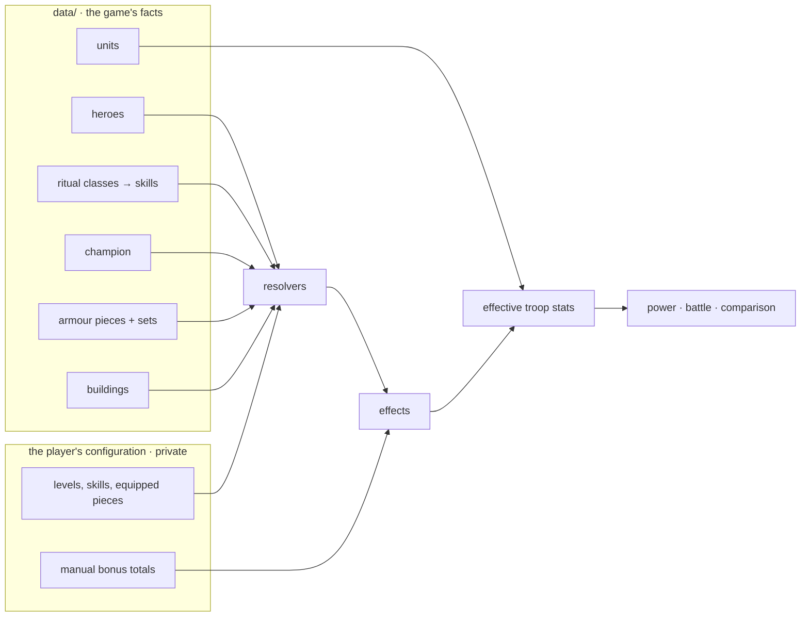

# Data model

[← Overview](../ARCHITECTURE.md) · What is built: [features.md](features.md) · Why: [decisions.md](decisions.md)

Two kinds of data, kept apart:

- **The game's facts**, the same for every player: units and defences (as of 22 October 2026); heroes, rituals, champion, armour and buildings
  later. JSON files in `data/<game>/`, one folder per game listed in `data/games.json` (D-13), versioned in the
  repo, transcribed from in-game screenshots.
- **A player's configuration**: their bonus totals, levels, troop limits and scenarios. It never enters the
  repo or any server: it lives in the player's browser and in the JSON files they export
  ([decisions.md](decisions.md), D-01 to D-03).

## One currency for every bonus: the effect

Whatever grants a bonus (a hero, a ritual skill, an armour set, a building), the engine only ever sees
**effects**. An effect raises one stat by a percentage, for the troops its target selects:

```json
{ "stat": "armour", "percent": 15, "target": { "alignments": ["khorne"], "tiers": [4, 5] } }
```

| Field     | Meaning                                                                                                                                                                                                            |
| --------- | ------------------------------------------------------------------------------------------------------------------------------------------------------------------------------------------------------------------ |
| `stat`    | a troop stat (`troopStats` in `data/<game>/game.json`) or an army stat (`armyStats`, such as `marchCapacity`)                                                                                                      |
| `percent` | the bonus, `15` for +15 %: from 0 to 100 (`bonusPercent` in `data/<game>/game.json`); stats marked `boostable: false` (squad size, food upkeep, squad power) take none (D-14)                                      |
| `target`  | which troops it applies to: any of `tiers`, `recruitments`, `attackTypes`, `unitTypes`, `alignments`, `buildings`, `units`; all given filters must match; empty or absent = every troop. Army stats take no target |

How the game combines percentages (added together, or multiplied) is not published: the engine adds them
until the calibration against battle reports says otherwise (D-12). The engine checks each bonus a player
enters and reports its problems as codes (`effectProblems`).

## Where effects come from: sources

A **source** turns the player's state (a level, a set of skills, equipped pieces) into effects. Each kind of
source has a resolver; the engine applies the effects of every source the same way. Adding a kind means
declaring its catalogue format, its resolver and its name in `sourceKinds`: the rest of the engine does not
change.



### Shapes

As of 22 October 2026, only `manual` exists: the player copies the totals shown in the game's boost summary. The other kinds
are **planned shapes**, written down so the data captured from now on fits them; their files will be created
with the feature that uses them, not before.

Most sources share one building block, a **levelled entry**: the effects it gives at each level.

```json
{
  "id": "example-hero",
  "name": "…",
  "levels": [
    { "level": 1, "effects": [] },
    { "level": 2, "effects": [] }
  ]
}
```

| Kind       | Catalogue (`data/`)                                                                                                        | Player state                          | Status  |
| ---------- | -------------------------------------------------------------------------------------------------------------------------- | ------------------------------------- | ------- |
| `manual`   | none                                                                                                                       | a list of effects                     | in use  |
| `hero`     | `heroes.json`: levelled entries                                                                                            | hero id → level                       | planned |
| `ritual`   | `rituals.json`: talent classes; each holds skills (levelled entries) with `requires`: the skills that must be learnt first | skill id → level                      | planned |
| `champion` | `champion.json`: levelled entry with the champion's own stats and the buffs it gives                                       | level                                 | planned |
| `armour`   | `armour.json`: pieces (slot, set, levelled entry) and sets (`bonuses`: effects from N pieces of the set)                   | piece id → level, for equipped pieces | planned |
| `building` | `buildings.json`: levelled entries                                                                                         | building id → level                   | planned |

## Units: `data/<game>/units.json`

One entry per troop type, transcribed from its in-game sheet ("Stats de l'unité"):

```json
{
  "id": "khorngor",
  "labels": { "fr": "Khorngor" },
  "building": "beastmen-herdstone",
  "recruitment": "training",
  "alignment": "khorne",
  "tier": 4,
  "attackType": "melee",
  "unitType": "monstrous-infantry",
  "stats": { "squadSize": 8, "foodUpkeep": 24, "squadPower": 60, "meleeAttack": 58, "meleeDamage": 800, "…": "…" }
}
```

| Field         | Read on the sheet                                                                             |
| ------------- | --------------------------------------------------------------------------------------------- |
| `labels`      | the title, as the game shows it: `fr` from the French game, `en` from the English game (D-08) |
| `building`    | the building whose screen lists the unit                                                      |
| `recruitment` | the tab: `training` (Entraînement) or `renown` (Notoriété: renowned units, won, not trained)  |
| `alignment`   | the god's icon at the top right (the Chaos star is `undivided`)                               |
| `tier`        | "Rang", in Roman numerals (I to VI)                                                           |
| `attackType`  | Mêlée or À distance, at the top left                                                          |
| `unitType`    | "Type d'unité"                                                                                |
| `stats`       | every other line of the stats table, under the ids of `troopStats` in `data/<game>/game.json` |

All values come from `data/<game>/game.json`. `rangedAttack` and `rangedDamage` are optional: the game hides them
for units that cannot shoot. The "Forteresse" figure is the player's own troop count, not a unit fact: it never
enters `units.json`.

## Defences: `data/<game>/defences.json`

One entry per fortress defence, with the same fields as a unit except `recruitment`; `unitType` is always
`defences` and `building` is `fortress-walls`. `stats` holds `squadPower`, `morale`, `armour`, `health`
and the attack and damage of its attack type, if it has one. Defences never appear in a scenario's troops
(D-11).

## Warlords: `data/<game>/warlords.json` (validated 2026-10-24)

One entry per warlord (33), written by `scripts/import-warlords.mjs` from cctools.cc's pages (D-25), never by hand;
credited in the README. The file is `{ "source", "talents", "warlords" }`; a warlord: Every per-level figure is a
list of 35 values, level 1 first: the file stays small (about 84 KB, the page bundles it) and a level is one
index. Rank and level within the rank are worked out from the level (level 12 = rank 3, level 2), never stored.

```json
{
  "id": "azazel",
  "labels": { "en": "Azazel", "fr": "Azazel*" },
  "alignment": "slaanesh",
  "rarity": "legendary",
  "tier": [4, 4, 4, "…", 5],
  "power": [3500, 7000, 10500, "…", 162500],
  "stats": {
    "meleeAttack": ["…"],
    "meleeDamage": ["…"],
    "armour": ["…"],
    "health": [500, 525, "…", 1600],
    "morale": ["…"],
    "speed": ["…"],
    "load": ["…"],
    "protection": ["…"]
  },
  "talents": { "slaanesh-health": [1, 1.5, 2, "…", 45], "slaanesh-ranged-damage": [null, null, "…", 50] }
}
```

| Field       | Meaning                                                                                                   |
| ----------- | --------------------------------------------------------------------------------------------------------- |
| `alignment` | the warlord's god, from the vocabulary (`undivided` for the Chaos star)                                   |
| `rarity`    | core, uncommon, rare, epic, legendary: a new list `rarities` in `game.json`, labels in both languages     |
| `tier`      | its tier at each level: it rises with the level (Azazel 4 then 5), and places it in the combat order      |
| `power`     | the power it adds at each level (like `squadPower` for a troop, for one hero)                             |
| `stats`     | its own fighting stats at each level, under the ids of `troopStats`, plus `protection` (open question 15) |
| `talents`   | each bonus it can give, in % at each level; `null` until the level that unlocks it (D-26: 4 in all)       |

**Talents** are named once, with the game's code (to import and trace) and what they do in our effect shape, so
a label comes from the stat and target labels already there. The 61 the import works out from their code
(`chaos_slaanesh_health_modifier` → `health` for `slaanesh`) are listed at the top of `warlords.json`
(`talents`); the 9 it cannot are named by hand in `game.json` (`talentCodes`: the march capacity, and the
bonuses that apply only in some battles, with their labels). An unknown code stops the import. A debuff's
values are negative (Gutrot Spume's Enemy Attack Debuff, −37 % at level 35):

| Kind (count)                     | Example code                                                                                                                        | In our effect shape                                                                                                                                                                      |
| -------------------------------- | ----------------------------------------------------------------------------------------------------------------------------------- | ---------------------------------------------------------------------------------------------------------------------------------------------------------------------------------------- |
| A stat for a god's troops (36)   | `chaos_slaanesh_health_modifier`                                                                                                    | `health`, target `alignments: ["slaanesh"]`                                                                                                                                              |
| A stat for a troop type (23)     | `chariots_health_modifier`                                                                                                          | `health`, target `unitTypes: ["chariots"]`                                                                                                                                               |
| The whole march (3)              | `march_speed_modifier`, `march_load_modifier`, `march_unit_capacity`                                                                | `speed`, `load`; `marchCapacity` (army stat)                                                                                                                                             |
| Damage against broken troops (1) | `broken_offense_combat_modifier`                                                                                                    | the model's `brokenRangedBonusPercent`, raised                                                                                                                                           |
| A context of battle (5)          | `march_combat_modifier`, `city_combat_modifier`, `rally_combat_modifier`, `empire_combat_modifier`, `city_attacker_attack_modifier` | kept, not applied yet: a "combat" bonus would raise every fighting stat of its side (to verify); Empire only against PvE troops; the debuff lowers the enemy's attack (open question 16) |
| Not about battle (2)             | `march_contest_modifier`, `random_reward_modifier`                                                                                  | kept and shown, never applied                                                                                                                                                            |

The counts are those of the 70 codes the 33 warlords use: 62 fit the effect shape as they are (36 + 23 + 3).

## A player's configuration

The format of what the browser saves and what an export file holds. `examples/configuration.example.json`
is a fictitious example, checked by the tests.

| Field           | Meaning                                                                                            |
| --------------- | -------------------------------------------------------------------------------------------------- |
| `schemaVersion` | format version; a newer app migrates an older file instead of rejecting it                         |
| `limits`        | the caps: `marchCapacity`, the most troops one army may hold (effects on `marchCapacity` raise it) |
| `sources`       | the player's bonuses: one `manual` source (2026-10-22)                                             |
| `scenarios`     | the options to compare: each a name and its troops (unit id → count)                               |

Scenarios are a list: the player keeps as many compositions as wanted, and compares any two of them (D-19).

## Combat rules: `data/<game>/combat-rules.json`

The rules the game publishes (3 turns, the attacker first, the order damage follows within a tier, the morale
test at 25 % losses), with their source. Under `model`, the parameters the game does not publish (D-16): the
damage and health divisors (from the community wiki), the tier modifier and the extra damage on broken troops
(0 until the calibration measures them).
